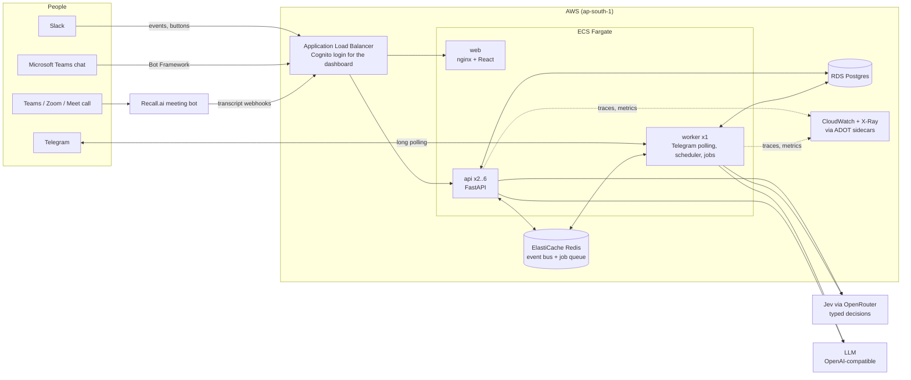

# Architecture

## The system on one page



## The loop, for every channel

1. **Follow up.** The scheduler (worker) or the dashboard picks stale or near-deadline tasks and messages each owner on the app they prefer.
2. **Receive.** Telegram (worker polling), Slack (`/api/slack/events`) or Teams (`/api/teams/messages`) turns the reply into a call to `service.handle_dm` or `service.handle_group`. Adapters only translate; the logic is shared.
3. **Understand.** `pipeline/decide.interpret`: exact words and buttons by rules, then **Jev**, then the LLM only if Jev is unsure, then field extraction (blocker, ETA, proof).
4. **Decide.** `pipeline/decide.gate` is plain code: anything waiting on someone is Blocked even if it says "done"; Complete needs no hedging and high confidence; uncertain cases go to the lead.
5. **Record.** Task row + append-only event (old → new, quoted message, engine, confidence, trace, snapshot for Undo).
6. **Act.** Confirm with Undo, ask the unblocker, warn owners of dependent tasks, catch teammates who believe something different.
7. **Show.** Redis pub/sub → every API task → Server-Sent Events → the dashboard updates live.

## Meetings

```mermaid
sequenceDiagram
  participant Lead
  participant API
  participant Recall as Recall.ai bot
  participant Worker
  participant Jev
  participant LLM
  participant Slack
  Lead->>API: Send agent (Teams link)
  API->>Recall: create bot (webhook URL with secret token)
  Recall-->>API: transcript.data (each line, live)
  API->>Worker: job: live triage
  Worker->>Jev: which task? update / blocker / commitment / decision?
  Note over Worker: call ends (webhook stops, worker polls bot status)
  Worker->>Jev: triage remaining lines
  Worker->>Worker: status lines → interpret + gate → lead reviews; done-claims → conflict check
  Worker->>LLM: summary from flagged lines + board only
  Worker->>Slack: summary to the project channel
  Worker->>Slack: action items to each owner (their own app)
```

**Why two stages.** A 30-minute call is hundreds of lines. Jev reads every line (fast, input-priced, no output tokens) and keeps the ones that matter; the LLM writes from those alone. Status heard in a meeting never changes the board directly: it becomes a lead review, because speech transcripts are noisy and people speak loosely.

**Without Recall.** Upload the `.vtt` Teams produces (meeting recap, "Download transcript"). The same pipeline runs. The Graph transcripts API returns the same format, so a Graph poller can feed `parse_transcript` later.

## Where Jev is used

| Place | Question types | Why Jev |
| --- | --- | --- |
| Chat replies (`pipeline/jev.py`) | choice: intent; noul: waiting on something, work remaining; score: progress | Narrow classification with calibrated probabilities; rules act on the numbers |
| Meeting triage (`meetings/analyze.py`) | choice: which task (from the live board); noul: update, blocker, commitment, decision | Hundreds of lines per call; cost and speed matter |
| Fallback when absent | rules (`pipeline/rules.py`) | The app always works without keys |

Jev returns no text, so the blocker phrase comes from the regex extractor or the LLM.

## Processes

| Process | Count | Runs |
| --- | --- | --- |
| api | 2..6 (autoscaled) | REST, SSE, Slack/Teams/Recall webhooks, sends replies |
| worker | exactly 1 | Telegram long polling (one poller per bot), scheduled check-ins, meeting jobs, Recall status polling |
| web | 2 | static React app |
| migrate | one-off per deploy | `alembic upgrade head && python -m app.cli seed` |

## Data model

`member` (with per-channel identities and preferred app) · `task` · `message` (every inbound/outbound message, any channel) · `event` (append-only status changes) · `review` (lead queue, source chat or meeting) · `correction` (lead overrides, reused as LLM examples) · `meeting` · `utterance` (transcript lines with triage flags).
